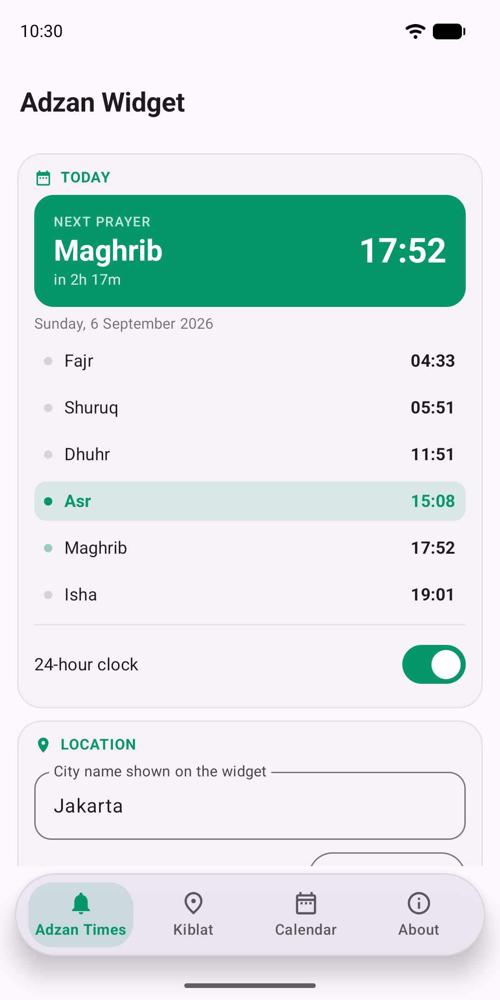
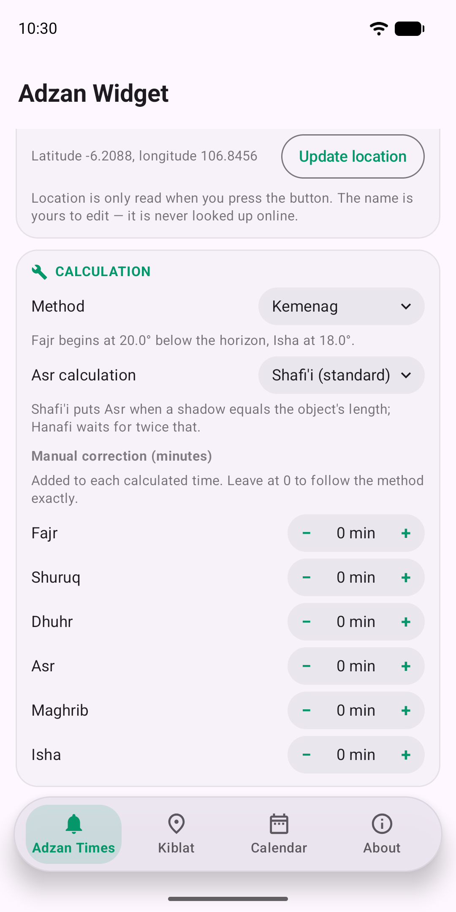
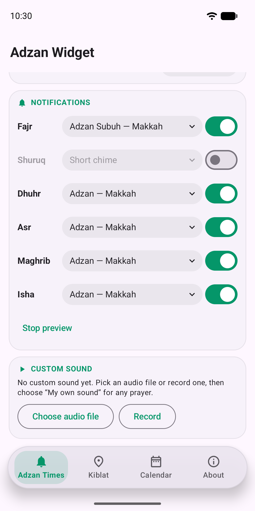
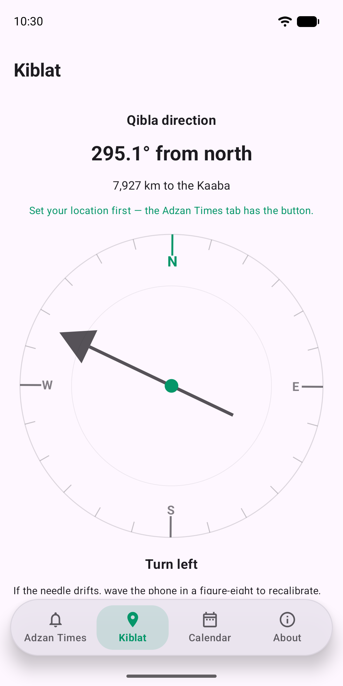

# Waktu Adzan / Adzan Time

A small offline Android prayer-time app with a home-screen widget.

The app has **no `INTERNET` permission**. Prayer times are computed on the device from your
coordinates using the standard solar-position algorithm, and every adzan recording is bundled
in the APK.

<p>
  
  
  
  
</p>

## Why I made this

I wanted prayer times on my home screen and the adzan at the right moment, nothing more.
The popular adzan apps are full of ads and trackers, and they need internet access for
something that is just maths on your own coordinates. This is the app I use every day: it works
fully offline, shows no ads, collects nothing, and keeps only the features I need.

## Features

- **Widget** — a 4×1 dark pill showing the clock, date, city and all six times, with the
  current period highlighted. Resizable; a narrower layout kicks in automatically below about
  three cells. The clock is a `TextClock`, so it updates itself with no alarm and no battery cost.
- **Location** — read from the platform `LocationManager` (GPS or network, no Play Services)
  only when you press *Update location*. The city name is a free-text field you own.
- **Notifications** — per prayer, each with its own bundled sound, plus a *Stop* action while
  the adzan plays. Subuh defaults to a recording that includes *as-salatu khairum minan-naum*;
  Syuruq defaults to a short chime rather than an adzan.
- **Jumuah** — Friday Dhuhr can use its own sound and, optionally, a fixed khutbah time.
- **Calculation** — Kemenag, MWL, ISNA, Egyptian, Karachi, Umm al-Qura, MUIS or custom angles;
  Shafi'i or Hanafi Asr; per-prayer manual correction in minutes.
- **Languages** — English and Bahasa Indonesia, following the system or set in-app.

## Building

Requires JDK 17+ and the Android SDK (compileSdk 36). Open this folder as the project root in
Android Studio, or use the wrapper script, which finds Studio's bundled JDK and your SDK on its
own and writes `local.properties` for you:

```
./build.sh              # debug APK  -> app/build/outputs/apk/debug/app-debug.apk
./build.sh test         # unit tests: the calculator vs. published schedules
./build.sh install      # build and adb install to the connected device
./build.sh release      # unsigned release APK, ~11 MB
./build.sh lint         # Android lint report
./build.sh all          # test + debug + release
./build.sh clean
```

Extra arguments go straight to Gradle (`./build.sh debug --offline`), and plain
`./gradlew assembleDebug` still works if you would rather set `JAVA_HOME` yourself.

## Signing a release

Release signing material is not in this repository. Copy `keystore.properties.example` to
`keystore.properties`, point `storeFile` at your own keystore and fill in the passwords. Both
files are gitignored. On CI, export `ANDROID_KEYSTORE_FILE`, `ANDROID_KEYSTORE_PASSWORD`,
`ANDROID_KEY_ALIAS` and `ANDROID_KEY_PASSWORD` instead. Without either, `./build.sh release`
produces an unsigned APK.

## Layout

| Path | What lives there |
|---|---|
| `prayer/PrayerCalculator.kt` | The solar maths. Pure JVM, unit-tested. |
| `prayer/Schedule.kt` | Turns a day into concrete instants, applies the Jumuah rules. |
| `data/Settings.kt` | Every preference, in one synchronous store. |
| `alarm/` | The chained exact-alarm scheduler, notification and playback service. |
| `widget/` | The `RemoteViews` widget provider. |
| `ui/` | The Compose settings screen. |
| `build.sh` | Toolchain-detecting build wrapper; see above. |

## Audio credits

The five adzan recordings are re-encoded (mono, 56 kbps) from public recordings on the
Internet Archive: Masjid al-Haram Dhuhr and Asr adhans, the Makkah Jumuah first adhan, and Fajr
adhans by Sheikh Mullah (Makkah) and Sheikh Surayhi (Madinah). Replace the files in
`app/src/main/res/raw/` to use your own.
